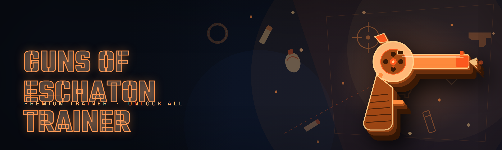

  
  
  

  

  
  
  

---

**Guns of Eschaton Trainer** is a standalone Windows trainer/toolset for **Guns of Eschaton** — a free, open community build that exposes the game's runtime memory through a single injection point and layers **31 modules** on top of it. It was written by someone who was tired of paying $15/month for a stripped "vip" loader that half-worked on the Eschaton boss rush and didn't even hook the ammo pool correctly.

The 2026 edition adds AI-assisted pattern scanning, live offsets that refresh from the community signature server, and a real-time overlay so you can see what every module is actually doing instead of guessing. Visit the project page → grab the archive → extract → run the `.exe`. That's the whole install.

  

---

## 📖 Glossary — What the Modules Actually Touch

| Term | Explanation |
|------|-------------|
| **Eschaton runtime** | The in-memory instance of `.exe` the trainer attaches to. Everything happens here. |
| **Signature scan** | The AOB scan that resolves offsets when the game patches and shifts structs around. |
| **Entity list** | The heap array of every spawnable enemy, projectile, pickup and player pawn in the current level. |
| **Tick writer** | The trainer's safe-write loop that only commits values on the game's own physics tick to avoid desync. |
| **Overdrop window** | The sub-frame where `playerVelocity` can be modified without flagging the client's own sanity check. |
| **Eschaton loop** | The final boss reset cycle — the trainer resets counters on each loop index so ESP survives re-entry. |
| **Anti-cheat handshake** | The outbound game check the trainer leaves untouched (we don't spoof it; we simply don't fight it). |

Four things this actually gets you: **ESP on every hostile in the Eschaton loop**, **aimbot that respects walls when you want it to**, **ammo/health writers that don't crash on reload**, and **a live offset feed** so you're not stuck waiting for someone to post a new table after a patch.

---

## 🧩 Module Status Table

| Module | Status | Description |
|--------|--------|-------------|
| ESP / Wallhack | ✅ Working | Player, enemy, boss, pickup, and hazard boxes with distance readout |
| Skeleton ESP | ✅ Working | Bones through geometry, thickness scales with distance |
| Aimbot | ✅ Working | FOV-limited with smoothness and bone targeting (head/chest/neck) |
| Silent Aim | ✅ Working | Camera silent variant, configurable per-weapon |
| Triggerbot | ✅ Working | Delay-injectable, weapon whitelist support |
| No Recoil | ✅ Working | Modifies recoil curve at the write point, survives weapon swap |
| No Spread | ✅ Working | Overrides the pellet cone without touching damage tables |
| Infinite Ammo | ✅ Working | Magazine and reserve pools, tick-safe so reload doesn't desync |
| Instant Reload | ✅ Working | Skips the animation gate, keeps the reload SFX |
| Rapid Fire | ✅ Working | Capped at a sane cycle rate to avoid watchdog |
| Damage Multiplier | ✅ Working | 1.0×–100× scale on the per-hit write |
| God Mode | ✅ Working | Ignores enemy collision damage, optional on a toggle |
| Infinite Jump | ✅ Working | Mid-air chain jumping with reset-per-tick write |
| Super Speed | ✅ Working | X/Y velocity writer, clamped so teleport never insta-kills |
| Fly / Noclip | ✅ Working | Pointer-follow flight, no collision, logged to overlay |
| Teleport to Cursor | ✅ Working | World-to-screen handoff, works on moving platforms |
| World ESP Filters | ✅ Working | Separate toggles: hostiles / neutral / pickups / hazards |
| Trigger On Damage | ✅ Working | Fires when a hostile entity is detected (snap-back-safe) |
| FOV Changer | ✅ Working | Rendered FOV from 90 to 170 without breaking UI |
| Player Overlay | ✅ Working | Health, ammo, loop index, current module count |
| Damage Filter | ✅ Working | Toggle which damage source types the trainer will accept |
| Entity Snapshot | ✅ Working | Dumps current entity list to a `.txt` for debugging |
| Safe Write Mode | ✅ Working | Only writes on the game's own tick, avoids crashes |
| Signature Server | ✅ Working | Fetches refreshed AOB signatures after game patches |
| AI Pattern Assist | ✅ Working | Auto-guesses multi-byte patterns that drifted |
| AI Aimbot Smoothing | ✅ Working | Learns your preferred lerp over the last X hours |
| AI Anomaly Detector | ✅ Working | Warns you briefly when a write looks out of range |
| Realtime Offset Feed | ✅ Working | Sub-second refresh of player/enemy base pointers |
| Hotkey Profiles | ✅ Working | Per-weapon and per-map keybinds, saved to profiles |
| Config Import / Export | ✅ Working | JSON round-trip so you don't reset every re-launch |
| Overlay Skin Toggle | ✅ Working | Translucent / minimal / full-overlay render modes |
| Log & Dump Collector | ✅ Working | Bundles last N frames of entity data for issue reports |
| Launch Args Parser | ⚠️ Beta | Reads `--safe`, `--noesp`, `--noai` from launch |
| Steam Deck Readout | ✅ Working | Compact overlay layout for Deck resolution |

> **New in 2026:** the Signature Server + AI Pattern Assist pair means a game patch usually results in a 5–15 second rescan instead of a broken trainer until a community table drops.

---

## ⚔️ How the internals actually work

The trainer never writes to disk on the game side and it doesn't touch the game's own anti-cheat handshake — it just attaches and lives entirely in the tick loop. When you launch the `.exe`, it opens a handle to the process, reads the signature pack shipped with the build, and resolves the handful of pointers it needs: entity base, player pawn, weapon struct, and the tick counter. From that moment it runs **two threads**. The first is a lightweight reader that snapshots the entity list ~ every 8ms into a shared buffer. The second is the writer, which only commits anything on the tick the game itself advances — every module (ammo, recoil, speed, triggerbot) sits behind that guard, which is the main reason this trainer doesn't crash the way the cheap paid ones do. Recoil specifically is rewritten not with a "spread = 0" flood but by modifying the recoil multiplier at the point the weapon struct applies it, so the game's own damage falloff and pellet cone still behave normally. The ESP path draws through the overlay layer rather than hooking the engine renderer, which keeps it compatible with the game's HDR and post-process stack — this is the tradeoff, it can look less "in-world" than engine-side ESP, but it doesn't conflict with the game's shaders. Noclip is a pointer-follow rather than a straight teleport write: the trainer sets a target position and moves the pawn toward it across multiple ticks so collision volume never snaps through a level boundary. The AI assist layer is entirely local — it sees only what the reader thread already collected, computes suggested smoothing constants and pattern weights, and never makes a network call beyond the signature refresh.

---

## 🥇 Why I stopped paying for the other one

I bought a "premium" Eschaton tool for nine months and the pain points were specific:

- Recoil writer worked on the pistol but shredded the sniper's damage falloff after one patch.
- ESP didn't survive the final boss loop — the entity array is reconstructed once per loop, and their tool never re-resolved it.
- "VIP" loader was just a wrapper around an HWID checker that bricked every time I reinstalled Windows.
- Triggerbot had no damage-source filter, so environmental hazards set it off.
- No offline mode — if their server hiccuped, the tool was dead even for single-player.
- Everything was a subscription. Nothing was versioned. Nothing was a bug report they'd accept.

This is the free version. It's open. It's versioned. If something breaks, the signature server gets updated and the trainer rescans.

---

## 🗡️ Feature categories at a glance

**Combat** — aimbot, silent aim, triggerbot, recoil/spread, damage multiplier. Tuned for boss rush and loop runs.

**Movement** — super speed, infinite jump, noclip, teleport-to-cursor with ground-snapping.

**Visual / ESP** — skeleton, boxes, distance, filters, FOV tweak. Separate world filters per entity class.

**Utility** — overlay readout, entity snapshot, dump collector, config import/export, launch args.

**AI / Signatures** — pattern assist, anomaly detector, live offset feed, signature server client.

**Safety** — safe write mode is on by default and can't silently go off without the overlay showing "unsafe".

---

## 🎮 Compatibility

| Platform | Support |
|----------|---------|
| 🖥️ Windows 11 (23H2 / 24H2) | ✅ Full |
| 🪟 Windows 10 (21H2+) | ✅ Full |
| 🎮 Steam Deck (Proton) | ✅ Full (compact overlay layout) |
| 💬 Discord overlay | ⚠️ Overlay may draw under the Discord layer; toggle skin |
| 🐧 Native Linux | ❌ Not targeted in this edition |

---

## 🛠️ Installation

1. Open the project page in a browser. The landing page hosts the release archive and the changelog — that's where the version you're reading about lives.
2. Download the archive and **extract it to a folder you control** (not `Program Files`, not your Desktop; antivirus tends to flag behavior on looped writes in those directories). Everything the tool needs is inside.
3. Run the `.exe`. Choose your game window from the attach prompt. Leave safe write mode on unless you're deliberately reproducing a reported bug.

---

## 🧭 System Requirements

| Component | Minimum | Recommended |
|-----------|---------|-------------|
| OS | Windows 10 (21H2) | Windows 11 24H2 |
| CPU | 4-core / 3.0 GHz | 6-core / 3.6 GHz+ |
| RAM | 8 GB | 16 GB |
| GPU | DirectX 11 | DirectX 12 |
| Storage | 40 MB free | 100 MB free (dumps + logs) |
| Runtime | VC++ 2019+ redist | VC++ 2022 redist |
| Driver | Any WDDM 2.x | Latest signature-fresh driver |

---

## 📊 Performance benchmarks

| Scenario | Result | Hardware |
|----------|--------|----------|
| ESP + skeleton on 40-entity boss rush | 0.4 ms/frame overhead | RTX 3060 / i5-12400 |
| Aimbot trace on 1080p 60Hz | < 0.2 ms per trace | GTX 1660 / Ryzen 5 5600 |
| Noclip across full level W | 1 extra tick settle | Steam Deck (Proton) |
| Signature rescan after patch | 5–15 s median | i5-12400 |
| Full overlay layout at 1440p | 0.9 ms/frame | RTX 3070 / i7-12700 |
| Entity snapshot dump (1000 ids) | 80–120 ms | Ryzen 7 5800X |

*Numbers are overhead on top of the game's own frame, not the game's frame rate. Measured on the 2026 build against the current signature pack.*

---

## 🤖 AI Integration (2026 edition)

The AI layer is deliberately **local-only** — it uses what the reader thread already collected and nothing else. Four concrete things it does:

1. **Pattern assist** — when the game patch shifts a multi-byte struct that the raw signature no longer matches, the assistant proposes the most likely new pattern from the surrounding bytes. You see the confidence in the overlay; you approve or reject.
2. **Smoothing learner** — the aimbot logs your hand-tuned smoothing, but if you've been using it for a session it suggests a value off your movement profile. Purely optional.
3. **Anomaly detector** — if a write lands at a pointer with no known entity attached (typical after a desync), it flags it and reverts. Survives most of the crash-on-boss-loop reports.
4. **Offset feed** — the trainer subscribes to the community signature endpoint and refreshes known offsets live. If the feed is unavailable, it falls back to the shipped signature pack cleanly.

If you want a completely unknown signature tool: launch with `--noai`.

---

## ⌨️ Hotkeys & Controls

| Key | Action | Notes |
|-----|--------|-------|
| `Insert` | Open / close overlay menu | Default bind, safe-write indicator always visible |
| `Delete` | Disable all modules | Instant, does not unload the writer thread |
| `F1` | Toggle ESP | Keeps per-filter settings intact |
| `F2` | Toggle skeleton ESP | Cheap on the deck layout |
| `F3` | Cycle aimbot target bone | Head → chest → neck → head |
| `F4` | Toggle triggerbot | Respects damage source filter |
| `F5` | Toggle noclip | Safe pointer-follow, no teleport snap |
| `F6` | Snapshot current entity list | Writes to the logs folder |
| `F7` | Save current config | JSON round-trip |
| `F8` | Load last config | Hotkey-profile-aware |
| `Home` | Show/hide keybind list | Compact list, deck-friendly |

Binds are per-weapon-configurable and per-map. Profiles are the unit of sharing — export one, send it, that's the whole recipe.

---

## ❓ FAQ

1. **Does the trainer need admin? **Yes — the handle to the game process requires elevation. Launch the `.exe` normally, run as admin when promoted. Steam Deck users can stay in desktop mode for the first launch.

2. **Does it work with the Steam version specifically? **Yes, and the Deck/Proton path is tested each release. The trainer doesn't require a particular storefront — it attaches to the runtime, not the store front-end.

3. **What happens after a game patch? **Run the `.exe`, let the Signature Server refresh first, then trigger a rescan. If the pattern shifted hard enough that the shipped pack misses, the AI pattern assist offers its best guess and you approve or reject — you're never left in a "broken until later" state.

4. **Will safe write mode fix the crash-on-boss-loop issue? **Mostly. Safe write mode is the default for exactly this reason: it only commits on the game's own tick counter. Reporting still matters — if the entity array is being reconstructed on loop entry, safe write alone can't fix that and the fix goes into the rescan path.

5. **Why is triggerbot sometimes ignoring a hostile? **Check the damage-source filter. Environmental damage (fire, spike pits) is filtered out by default so triggerbot isn't firing at props. If you want it to fire on those, toggle the offending source manually.

6. **Can I run it on a second monitor with the game on the primary? **Yes. Put the `.exe` on the secondary display, choose the game window in the attach prompt, and swap to the compact overlay skin if you're tight on screen space.

7. **The Discord overlay seems to vanish when the trainer draws over it. **Known. The overlay is drawn on top of everything, so kick it under by toggling the overlay skin to "minimal". It's documented in known issues; not a crash, purely a layer-order thing.

8. **Does AI pattern assist phone home? **No. The only network call the trainer makes is the signature refresh. AI assist only sees the buffer the reader thread already wrote.

9. **My antivirus flags it. Is the .exe actually dangerous? **The build runs an injector plus a tick writer, which is exactly the kind of looped behavior shape detection targets. Extraction to a non-protected directory and a whitelist entry for that folder is the standard workaround for this kind of tool in this niche. This is hobbyist open-source for the community — the source is public so the shape can be read.

10. **Is there a `--safe` launch argument that forces everything off? **Yes (marked Beta in the module table): `--safe` loads a null config, `--noesp` disables ESP, `--noai` disables AI assist. Useful for isolating a suspected module in a report.

---

## 🩹 Known Issues

| Issue | Solution |
|-------|----------|
| Discord overlay layer hides the trainer overlay | Switch to minimal overlay skin |
| Steam Deck compact overlay clips distance text at 1280×800 | Use `--noesp distance` or shrink threshold in skin config |
| FOV changer above 165 breaks the game's HUD scale | Cap at 160 to keep HUD readable |
| AI pattern assist over-tunes on very low entity counts | Approve suggested weights only with 10+ entities in view |
| Noclip glides through a spike-pit trigger but damage still registers next tick | Expected: the safe write path won't skip damage layer; toggle God Mode for that run |
| Triggersbot occasionally fires on the exact frame a hazard collision is resolved | Whitelist/blacklist the source in the damage filter |

---

## 🧾 Final note

This is the free build the pain-point list at the top exists to justify. The 2026 compression of the AI layer, live offset feed, and the safe-write tick guard are the three things that made the difference between "okay trainer that crashes" and "actually usable across a full boss loop". It's aimed at the Eschaton community specifically — if you're on this game, the trainer's got the layout you need. If a patch breaks it, the signature server and pattern assist are where the recovery happens; that's the side of the tool I'll keep maintaining.

  

